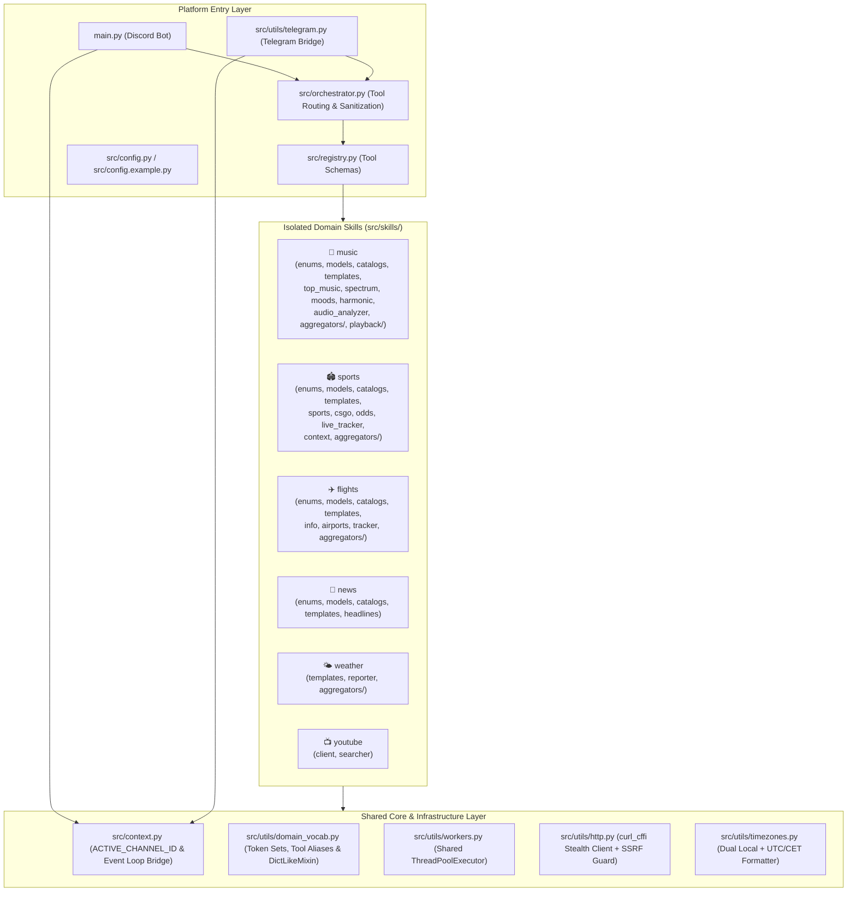

# 🤖 Local Ollama Multi-Skill Discord & Telegram AI Agent

A privacy-first, locally hosted AI research and entertainment assistant for **Discord** and **Telegram**, powered by **Ollama** (`gemma4:e4b`, `qwen3:8b`, etc.) with a modular, multi-threaded Python skill engine.

Designed specifically to give compact local LLMs (4B–8B parameters) **deterministic, real-time tool execution**, pre-verified links, timezone-aware schedules, and background event tracking without relying on paid cloud LLM APIs.

---

## ✨ Key Capabilities

| Domain | Capabilities |
| :--- | :--- |
| 🎵 **Music Discovery & Audio DSP** | Multi-source chart & underground discovery (**Last.fm**, **Deezer**, **Beatport**, **FreqBlog**, **iTunes RSS / Billboard**), **Genre × Mood Matrix**, **3×3 Tempo × Intensity Spectrum Shifting** (`faster`, `slower`, `harder`, `softer`), **In-Memory DSP (`miniaudio` + `numpy`) BPM/Key/Gain Analysis**, native **`gemma4:e4b` Audio Listening**, and **👍 Song-Card Reaction Similar-Track Discovery**. |
| 🏟️ **Live Sports, CS2 Esports & Decimal Odds** | Real-time scoreboards, fixtures, and standings for **Soccer** (UCL, EPL, La Liga, Serie A, Bundesliga, Ligue 1, MLS, etc.), **NHL**, **NBA**, **NFL**, **MLB**, **UFC**, **Formula 1** (3-day session timings & driver/constructor standings), and **Counter-Strike 2** (**HLTV**, **Liquipedia**, **ESL/BLAST** live streams). Includes **Decimal Betting Odds** with implied win probabilities and **Background Live Match Tracking** (kickoff, goals, red cards, period/halftime, full-time alerts). |
| ✈️ **Flights, Airfare Calendars & Live Radar** | Live **Google Flights** itinerary scraping (Best, Cheapest, Shortest/Fastest), **Round-Trip & Flexible-Date Price Grids**, **Direct/Nonstop Route Schedules**, and **Live Commercial Flight Status & Radar Telemetry** (**Flightradar24** & **ADSB.lol** live ADS-B altitude/groundspeed/heading). Includes **Background Flight Status & Route Price Drop Alerts**. |
| 🌐 **Web Research, News & Weather** | Multi-engine web search (**DuckDuckGo** + **Brave Search** fallback), SSRF-hardened stealth article reader (**Jina Reader** + **curl_cffi** TLS impersonation), **YouTube Transcript & Metadata** analyzer, **Google News RSS** headlines, and **wttr.in** weather forecasts. |
| 💬 **Dual-Platform Discord + Telegram** | Runs simultaneously on **Discord** (with per-channel concurrency locks and 👍 song-card reactions) and **Telegram** (zero-dependency HTTPS long-polling bridge with fail-closed user/chat allowlist security). |

---

## 🏗️ Architecture Overview

Skills are strictly isolated by domain and follow a standardized internal module layout (`enums.py`, `models.py`, `catalogs.py`, `templates.py`). Cross-cutting concerns live in a shared core execution context (`src/context.py`), shared domain vocabularies (`src/utils/domain_vocab.py`), and a centralized background worker pool (`src/utils/workers.py`).



---

## 🚀 Getting Started

### 1. Prerequisites
- **Python 3.11+** (tested up to Python 3.14)
- **[Ollama](https://ollama.com/)** running locally (`ollama serve`)
  - Pull your preferred model(s), e.g.:
    ```bash
    ollama pull gemma4:e4b
    ollama pull qwen3:8b
    ```

### 2. Installation
Clone the repository and install dependencies into a virtual environment:

```bash
git clone <your-repo-url>
cd discord-bot
python -m venv .venv
# Windows PowerShell:
.\.venv\Scripts\Activate.ps1
# Linux / macOS:
# source .venv/bin/activate

pip install -r requirements.txt
```

### 3. Configuration (`.env` and `src/config.py`)
1. Copy the environment variable template and add your **Discord Bot Token** (and optional API keys):
   ```bash
   cp .env.example .env
   ```
2. Copy the public bot persona/model configuration template to `src/config.py` (which is git-ignored so your custom prompts and local model tags stay private):
   ```bash
   cp src/config.example.py src/config.py
   ```
   *(If `src/config.py` is omitted, the bot automatically loads the default `research` and `chat` profiles from `src/config.example.py`.)*

### 4. Run the Bot
```bash
python main.py
```

---

## 🎮 Commands & Natural Language Prompts

### Bot Commands & Interactions
| Discord | Telegram | Description |
| :--- | :--- | :--- |
| `!mode <profile>` | `/mode <profile>` | Switch active AI model/persona profile (e.g., `research`, `chat`; restricted to `BOT_OWNER_ID`). |
| `!reset` | `/reset` | Wipe conversation history and per-channel tool caches for the current channel. |
| React with 👍 on a song card | — | Automatically finds and posts a fresh, acoustically similar song to the reacted track. |

### Natural Language Examples
- **Music Discovery & Spectrum Shifts**:
  - *"Play me a dark techno banger"*
  - *"Give me something a little faster and harder"* (or reply directly to a song card with *"slower"* / *"softer"*)
  - *"Find tracks that harmonically mix with Strobe by Deadmau5"*
- **Sports, CS2 Esports & Live Match Tracking**:
  - *"What are the Champions League and NHL games today and their odds?"*
  - *"When is the next F1 race and what are the session times?"*
  - *"What's happening in CS2 right now and what are Vitality's player stats?"*
  - *"Track the Real Madrid game"* / *"Which games are we tracking right now?"* / *"Stop tracking the Real Madrid game"*
- **Flights, Airfare Calendars & Live Radar Tracking**:
  - *"Find the cheapest round-trip flights from New York to Tokyo in November for 2 weeks"*
  - *"When are the direct flights from JFK to LHR?"*
  - *"Where is flight BA117 right now?"*
  - *"Track flight BA117"* / *"Track the price for JFK to LHR on Nov 21"* / *"Stop tracking flight BA117"*

---

## 🧪 Running the Test Suite

The repository includes **260+ unit, concurrency, combinatorial, and architectural boundary tests** (executing completely offline in ~6 seconds):

```bash
python -m unittest discover -s tests -p "test_*.py"
```

To run the architectural & module boundary guardrails specifically:

```bash
python -m unittest tests/test_architecture_and_boundaries.py
```

See [CONTRIBUTING.md](CONTRIBUTING.md) for code quality standards and skill authoring guidelines.
