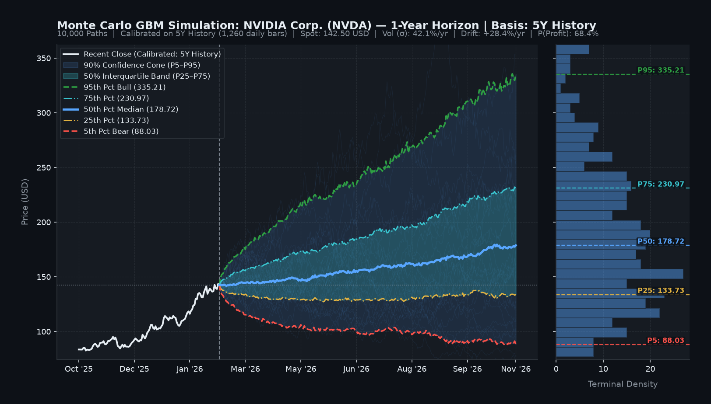
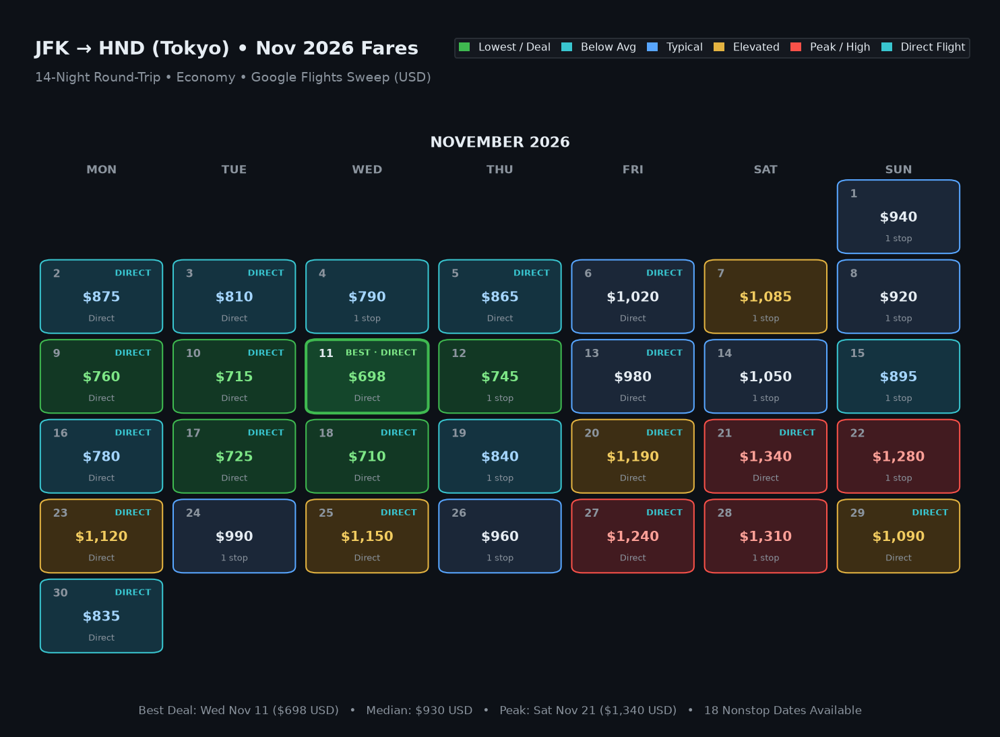
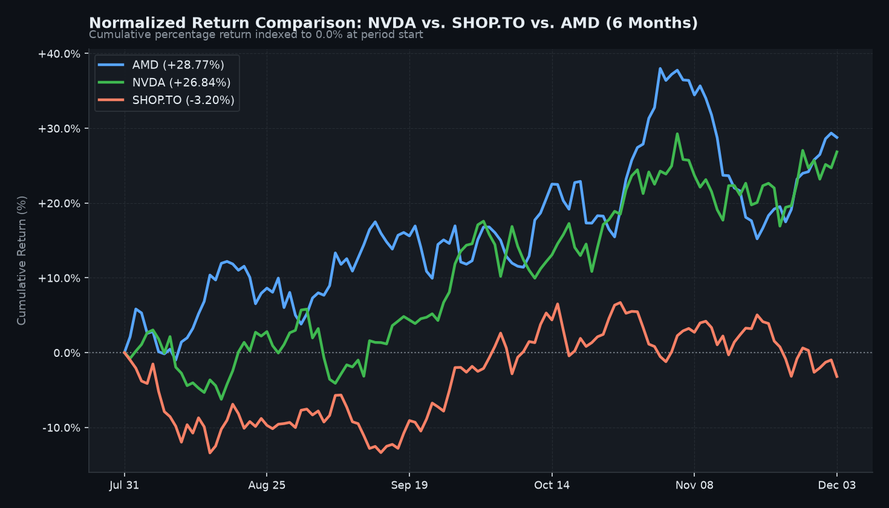
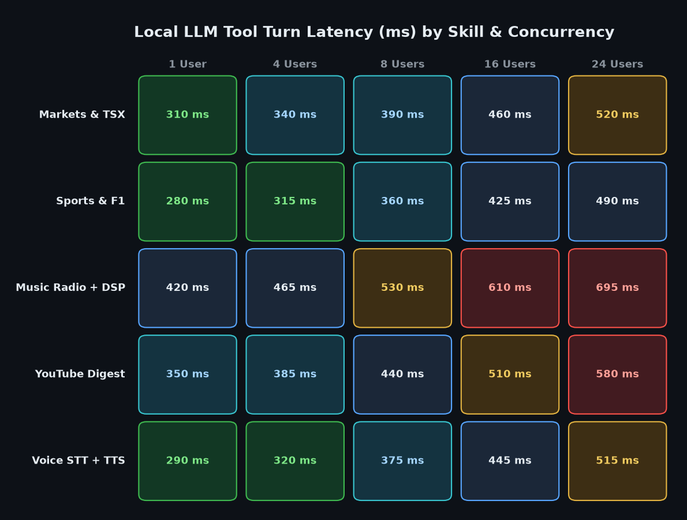
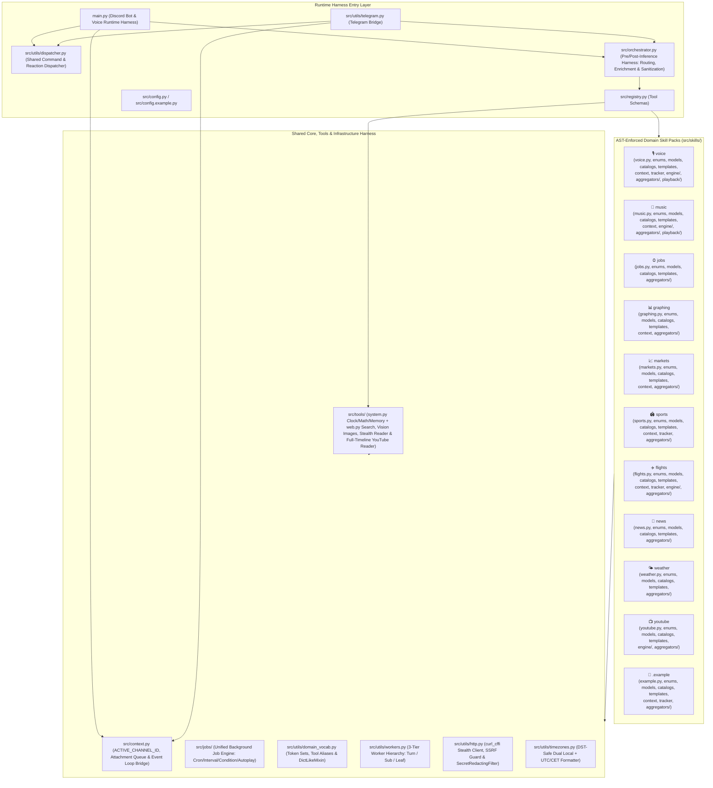

# 🤖 Local LLM Runtime Harness & Real-Time Voice Engine

A privacy-first, locally hosted **AI Runtime Harness, Real-Time Discord Voice Co-Host, and AST-Enforced Skill Framework** for **Discord** and **Telegram**, powered by **Ollama**.

Raw `4B–8B` local models frequently skip tool schemas, hallucinate URLs, miscalculate timezones, and overwrite structured outputs—while fast-moving AI codebases often degrade into tightly coupled spaghetti. This project solves both problems with **two interlocking harnesses**:

1. **The Agent Runtime Harness (`src/orchestrator.py`, `main.py`, `src/utils/workers.py`, `src/jobs/`)**: Deterministic pre- and post-inference scaffolding that wraps compact `4B–8B` local models so they execute multi-threaded tools, compound multi-skill turns, full-timeline video analysis, dynamic background jobs, and **real-time Discord DAVE E2EE voice co-hosting** without hallucinating.
2. **The AST-Enforced Coding Harness (`src/skills/.example/`, `tests/test_architecture_and_boundaries.py`)**: A strict, constructor-style Python skill contract and **397-test offline verification gate** that mechanically prevents human developers and AI coding agents from introducing cross-skill coupling, thread-pool deadlocks, or architectural drift.

---

## 📸 Visual Showcase (Rendered On-Demand via the Runtime Harness)

| **10,000-Path Monte Carlo Price Simulation** | **Monthly Airfare Deal Calendar Heatmap** |
| :---: | :---: |
| <br><sub>`skill_graphing_info(chart_type="monte_carlo", ticker="NVDA", timeframe="1y")`</sub> | <br><sub>`skill_flight_info` automatic 7-column `MON–SUN` fare grid with nonstop badges</sub> |
| **Multi-Ticker Normalized `%` Return Overlay** | **2D Annotated Matrix Heatmap** |
| <br><sub>`skill_graphing_info(chart_type="market", ticker="NVDA, SHOP.TO, AMD", timeframe="6mo")`</sub> | <br><sub>`skill_graphing_info(chart_type="heatmap")` multi-series matrix card</sub> |

---

## 🧠 The Dual-Harness Architecture (Runtime Harness + Coding Harness)

| Harness Layer | What It Enforces & Solves |
| :--- | :--- |
| 🎯 **Pre- & Post-Inference LLM Runtime Harness** | • **Code-First 1-Turn Execution**: Typed Python skills + 3-line `templates.py` suffixes replace fragile multi-turn `SKILL.md` prompt improvisation.<br>• **Turn-0 Missed-Tool & Compound Co-Execution**: Automatically intercepts missed tool calls and co-executes paired tools on compound prompts (e.g., `markets` + `graphing`, `voice` + `music`, `news` + `market pulse`).<br>• **Stateful Argument & Timezone Enrichment**: Normalizes parameter aliases, recovers multi-turn context, and injects DST-safe dual Local + UTC/CET timestamps.<br>• **Post-Model Output Guardrails**: Preserves verified cards and job confirmations against LLM rewrites and blocks phantom schedule claims. |
| 🏛️ **AST-Enforced Coding & Skill Harness** | • **Zero Cross-Skill Coupling**: AST static analysis tests fail the build if any domain skill imports from a sibling skill package.<br>• **Strict Module Separation**: Enforces `StrEnum` in `enums.py`, `@dataclass(slots=True)` in `models.py`, and static tables in `catalogs.py`.<br>• **Copy-Paste Skill Contract**: `src/skills/.example/` provides a drop-in skeleton so humans and AI coding agents author skills identically.<br>• **397 Offline Verification Tests**: Full unit, combinatorial, concurrency, and security suite runs completely offline in ~15–25 seconds. |
| 🎙️ **Real-Time Discord DAVE E2EE Voice Co-Host & Streamer** | • **DAVE E2EE Decryption**: Real-time `davey` Opus decryption with per-speaker `48 kHz` SSRC demuxing and VAD (`0.30s` silence gap).<br>• **Sub-Second Local STT & 9 Neural Voices**: Pre-warmed `faster-whisper` (`int8`) transcription and 9 `edge-tts` voice/accent presets (`!voice <preset>`).<br>• **3 Listening Modes**: Switch live between `wake_word` (`"Hey bot"`), `conversational` (open mic), and `listen_only` with call recaps (`!vrecap`).<br>• **Ad-Free Voice Music Streaming**: Streams Song Cards and Autoplay radio directly into voice via `yt-dlp` + `FFmpegPCMAudio` (`!pause`, `!skip`, `!queue`). |
| ⏰ **Unified Background Job, Cron & Condition Harness** | • **One-Shot & Recurring Schedules**: Natural-language reminders and cron/interval routines (`!remind`, *"every Monday at 9am..."*).<br>• **Scheduled Multi-Skill & Graphing Tasks**: Runs full agent turns on schedule and delivers rendered PNG chart attachments automatically.<br>• **Dynamic Condition Evaluators**: Polls market price/move thresholds, weather shifts, YouTube channel uploads, and web keywords.<br>• **Continuous Radio Autoplay**: Background station scheduler (`!autoplay` / `!stopautoplay`) with 1-hour idle protection and real-duration timers. |
| 🔒 **Hardened Concurrency, Security & Dual-Platform Bridge** | • **3-Tier Deadlock-Free Worker DAG**: Isolates `WORKER_POOL` (`16`) → `SUB_WORKER_POOL` (`24`) → `LEAF_WORKER_POOL` (`32`) with `contextvars` propagation.<br>• **End-to-End SSRF & Redirect Guards**: Blocks private, loopback, link-local, and cloud-metadata IPs on every HTTP hop and media stream.<br>• **Automatic Secret Redaction**: `SecretRedactingFilter` scrubs bot tokens and API keys from logs, exceptions, and cache keys.<br>• **Dual Discord + Telegram Runtime**: Owner-gated DMs (`BOT_OWNER_ID`), mass-ping sanitization, and fail-closed Telegram allowlist security. |

---

## 🧩 Built-In Modular Skill Packs (`src/skills/` & `src/tools/`)

Every domain below is an isolated package built on the [`src/skills/.example/`](src/skills/.example/) coding harness contract and orchestrated together across single- and multi-tool turns.

| Skill Pack | Capabilities |
| :--- | :--- |
| 📊 **`graphing`**<br>Charts, Monte Carlo & Diagrams | • **10,000-Path Monte Carlo**: Forward price cones (P5–P95), terminal histograms, and win/drawdown odds (calibrated on 5Y history by default).<br>• **Financial & FX Plots**: Separate true-scale charts by default when listing multiple tickers, or normalized `%` overlays on `"compare"` / `"vs"`.<br>• **2D Charts & Heatmaps**: Dark-themed `bar`, `stacked_bar`, `line`, `area`, `scatter`, `pie`, `donut`, `heatmap`, and `calendar_heatmap` PNGs.<br>• **Mermaid & Flowcharts**: Renders `flowchart`, `sequence`, `architecture`, and `state` diagrams with an offline Matplotlib fallback. |
| 📈 **`markets`**<br>Global Macro, TSX/Stocks & Crypto | • **Global Macro Pulse**: Live S&P/TSX, S&P 500, Nasdaq 100, Europe/Asia indices, VIX, Gold, WTI Crude, FX, 10Y Yields, and Risk-On/Off regime.<br>• **Equities & Crypto**: US/Canadian `.TO` stocks, ETFs, CoinGecko top movers, and DeFi TVL.<br>• **Performance & Risk**: Multi-timeframe returns (`1d`–`5y`), annualized volatility, and max drawdown.<br>• **Fundamentals & Portfolios**: Valuation multiples, next earnings dates, side-by-side comparison matrices, and portfolio valuation. |
| 📺 **`youtube` & `web`**<br>Full-Timeline Video, Vision & Web | • **Full-Timeline (`0%–100%`) Video Reader**: Verbatim timestamped transcripts (`<= 12.5k` chars) or **6–10 chronological chapter digests** for 1h–10h+ videos.<br>• **Targeted `query` & Timestamp Zoom**: Extracts verbatim transcript lines around a requested topic or timestamp (`45:00`, `1:15:00`) alongside the full digest.<br>• **Vision-Verified Image Search**: `search_images` verifies web and article images in RAM using `gemma4:e4b` multimodal vision.<br>• **Stealth Web Reader & Search**: Multi-engine search (**DuckDuckGo** + **Brave** fallback) and SSRF-hardened article reader (**Jina** + **curl_cffi**). |
| 🎵 **`music`**<br>`ytmusicapi` Radio, Autoplay & DSP | • **Blended Multi-Source Discovery**: Combines **YouTube Music (`ytmusicapi`)** watch-playlist radio (~40%) with **Last.fm**, **Deezer**, **Beatport**, and **iTunes** (~60%).<br>• **3-Shelf Crate-Digging Sampler**: Balances 45% Anthems / 35% Cult / 20% Underground with cross-source genre gatekeeping.<br>• **3×3 Spectrum Shifting & Autoplay**: Shift `faster`, `slower`, `harder`, `softer`, or launch `!autoplay` from a genre, song/artist, or YouTube URL.<br>• **In-Memory Audio DSP**: Decodes preview streams via `miniaudio` + `numpy` for BPM, Camelot key, and LUFS/gain analysis, plus 👍 reaction discovery. |
| 🏟️ **`sports`**<br>Live Scores, F1 Telemetry & CS2 | • **Major Leagues**: Live scoreboards, schedules, and standings for Soccer (UCL, EPL, La Liga, Serie A, MLS, etc.), NHL, NBA, NFL, MLB, and UFC.<br>• **Formula 1 Live Telemetry**: **OpenF1 + BBC Sport + ESPN** 3-day timings, live `Lap X/Y` counter, Safety Car alerts, and Q1/Q2/Q3 qualifying summaries.<br>• **Counter-Strike 2 Esports**: **HLTV** & **Liquipedia** live match ticker, brackets, player ratings, and **ESL / BLAST / PGL** live streams.<br>• **Decimal Odds & Live Tracker**: Implied win probabilities and fault-isolated background match polling (`!track`) with voice break-in alerts. |
| ✈️ **`flights`**<br>Airfare Calendars & Live Radar | • **Google Flights Search**: Best, Cheapest, and Fastest itineraries plus direct/nonstop route schedules.<br>• **Visual Fare Calendar Heatmaps**: Round-trip & flexible-date sweeps auto-attach a color-coded `MON–SUN` monthly deal calendar PNG.<br>• **Live ADS-B Radar Telemetry**: Real-time commercial flight status, altitude, groundspeed, and heading via **Flightradar24** & **ADSB.lol**.<br>• **Background Alerts**: Live flight status and route price-drop tracking (`!trackflight`). |
| 📰 **`news` & `weather`**<br>Headlines & 16-Day Forecasts | • **Google News RSS**: Category and regional editions enriched with a live **Daily Global Market Pulse**.<br>• **16-Day Weather Forecasts**: **Open-Meteo** current conditions, hourly precipitation, and 16-day outlook with **wttr.in** automatic fallback. |

---

## 🛡️ Fault-Tolerant Multi-Provider Fallback Chains

External web endpoints change DOM structures and rate limits over time. To prevent upstream changes from breaking the runtime harness, every skill inherits from `Base<Domain>Aggregator` with automatic multi-provider fallback chains:

| Domain | Primary Provider(s) | Automatic Fallback(s) |
| :--- | :--- | :--- |
| **Web Search & Reading** | DuckDuckGo (`ddgs`) / Jina Reader API | Brave Search API / `curl_cffi` TLS impersonation + local BeautifulSoup |
| **Markets & Charting** | Yahoo Finance v8 Chart & Quote API | TradingView Scanner API + CoinGecko + DeFiLlama |
| **Diagrams & Graphing** | Mermaid.ink Dark PNG API | Kroki.io PNG API → Local Matplotlib Directed-Graph Renderer (100% offline) |
| **Music & Radio** | `ytmusicapi` Watch-Playlist Radio + Last.fm | Deezer Search/Playlists + Beatport + FreqBlog + iTunes RSS |
| **Sports, F1 & Odds** | ESPN Hidden API + OpenF1 Telemetry + The Odds API | BBC Sport Live Qualifying + HLTV / Liquipedia + Stealth Odds Scraper |
| **Flights & Radar** | Google Flights (`fast-flights` / `primp`) + Flightradar24 | ADSB.lol Live ADS-B Transponder API |
| **Weather & Voice** | Open-Meteo API / `faster-whisper` (`int8`) + `edge-tts` | `wttr.in` JSON API / `gemma4:e4b` native audio + offline WAV tone fallback |

---

## 🏗️ Harness Architecture & Skill Contract

Every domain skill under `src/skills/` follows an identical, AST-enforced package layout (`__init__.py`, `<skill_name>.py`, `enums.py`, `models.py`, `catalogs.py`, `templates.py`, `aggregators/`, plus optional `context.py`, `tracker.py`, `engine/`, `playback/`), with a copy-paste-ready skeleton in `src/skills/.example/`. Cross-cutting runtime harness components live in `src/orchestrator.py`, `src/tools/`, `src/jobs/`, `src/context.py`, and `src/utils/`.



### 📁 Standard Skill Package Layout (`src/skills/<skill_name>/`)

Every skill package under `src/skills/<skill_name>/` follows this exact structure, with the primary module named `<skill_name>.py` to match its folder name (see `src/skills/.example/` for a copy-paste-ready skeleton):

```text
src/skills/<skill_name>/
├── __init__.py             # Public exports (skill_<skill_name>_* entrypoints & optional tracker)
├── <skill_name>.py         # Constructor-style main module with LLM tool entrypoint(s) (skill_<skill_name>_*)
├── enums.py                # Strictly enum.StrEnum classes (modes, states, providers)
├── models.py               # Strictly @dataclass(slots=True) domain models
├── catalogs.py             # Strictly static registries, lookup dicts & frozenset stopwords
├── templates.py            # Concise LLM formatting instructions (3–4 lines max)
├── context.py              # [Optional] Per-channel state, arg enrichment & turn-0 recovery
├── tracker.py              # [Optional] Asyncio background polling service (<Domain>TrackerService)
├── engine/                 # [Optional] Pure domain algorithms, parsers, or DSP helpers
├── playback/               # [Optional] Audio/media streaming & Discord voice sinks
└── aggregators/            # External API & scraping providers
    ├── __init__.py
    ├── base.py             # Abstract base class (Base<Domain>Aggregator)
    └── example_provider.py # Concrete data fetcher using src/utils/http.py & workers.py
```

#### 🧩 Adding a New Skill in 5 Steps
1. **Copy the skeleton** to `src/skills/<your_skill>/` and rename `example.py` to `<your_skill>.py`:
   ```bash
   cp -r src/skills/.example src/skills/<your_skill>
   mv src/skills/<your_skill>/example.py src/skills/<your_skill>/<your_skill>.py
   ```
2. **Define your types & static data**:
   - Put `StrEnum`s in `enums.py`, `@dataclass(slots=True)` models in `models.py`, static dicts/`frozenset` stopwords in `catalogs.py`, and concise LLM rules in `templates.py`.
3. **Implement your data provider** in `aggregators/` inheriting from `Base<Domain>Aggregator` in `aggregators/base.py`, using `fetch_json` / `fetch_text` from `src.utils.http` and `map_in_workers` / `submit_to_worker` from `src.utils.workers`.
4. **Implement your tool entrypoint** (`def skill_<your_skill>_info(...) -> str:`) in `<your_skill>.py` and export it in `src/skills/<your_skill>/__init__.py` and `src/skills/__init__.py`.
5. **Register the tool** in `src/registry.py` (`RESEARCH_TOOLS` / `CHAT_TOOLS`) and add parameter synonyms to `TOOL_ARG_ALIASES` in `src/utils/domain_vocab.py`.

#### 💡 Why a Code-First Runtime Harness Instead of `SKILL.md`?
Many coding and OS agents (like Claude Code, Cursor, or OpenClaw) use `SKILL.md` files — Markdown instruction manuals that a large cloud model reads at runtime to figure out what shell commands or scripts to run across multiple turns.

This runtime harness intentionally uses **compiled Python skill packages + `templates.py`** instead:
- **Built for Fast Local Models (`4B–8B`)**: Rather than asking a small local model to read a Markdown guide and improvise CLI commands across 3–4 turns, each skill exposes a strict, typed Python function (`<skill_name>.py`) and appends concise formatting rules (`templates.py`) directly to the tool output in a **single turn**.
- **Deterministic Speed & Concurrency**: Heavy lifting — like 3-tier deadlock-free worker fan-out, API fallback chains, full-timeline transcript salience scoring (`O(1)` stride-sampling safety for 10h+ streams), and in-memory MP3/PCM signal processing — runs in deterministic, unit-tested Python rather than prompt instructions.

---

## 🚀 Getting Started

### 1. Prerequisites
- **Python 3.11+** (tested up to Python 3.14)
- **[Ollama](https://ollama.com/)** running locally (`ollama serve`)
  - Pull your preferred model(s), e.g.:
    ```bash
    ollama pull gemma4:e4b
    ollama pull qwen3:8b
    ```

### 2. Installation
Clone the repository and install dependencies into a virtual environment:

```bash
git clone <your-repo-url>
cd discord-bot
python -m venv .venv
# Windows PowerShell:
.\.venv\Scripts\Activate.ps1
# Linux / macOS:
# source .venv/bin/activate

pip install -r requirements.txt
```

### 3. Configuration (`.env` and `src/config.py`)
1. Copy the environment variable template and add your **Discord Bot Token** (and optional API keys):
   ```bash
   cp .env.example .env
   ```
2. Copy the public bot persona/model configuration template to `src/config.py` (which is git-ignored so your custom prompts and local model tags stay private):
   ```bash
   cp src/config.example.py src/config.py
   ```
   *(If `src/config.py` is omitted, the harness automatically loads the default `research` and `chat` profiles from `src/config.example.py`.)*

### 4. Run the Harness

#### Option A: Run Natively
```bash
python main.py
```

#### Option B: Run in a Hardened, Self-Contained Docker Stack (`ollama` + `discord-bot`)
For complete filesystem and network isolation from the host machine (pre-configured with `libopus0`, `libsodium23`, and `ffmpeg` for Discord Voice Co-Hosting & Music Streaming):
```bash
docker compose up -d --build
```
- **Dedicated GPU `ollama` Container**: Runs `ollama/ollama` inside a sibling container on a private internal bridge network (`http://ollama:11434`) with GPU passthrough (`capabilities: [gpu]`) and an isolated `ollama_models` volume. Missing models in `MODES` are pulled automatically on first boot (`OLLAMA_AUTO_PULL=true`).
- **Zero Host Bind-Mounts**: No host folders are mounted into either container (`ollama_models`, `bot_data`, `bot_workspace`, and `bot_hf_cache` use isolated Docker-managed named volumes).
- **Read-Only Root Filesystem**: `/`, `/usr`, and `/app` in `discord-bot` are mounted read-only; the process runs as an unprivileged user (`1000:1000`) with `cap_drop: [ALL]` and `no-new-privileges:true`.

---

## 🎙️ Discord Voice-Channel AI Co-Host Guide

The runtime harness can join any Discord voice channel and participate as a real-time, voice-activated AI co-host while retaining full access to all domain skills and web tools.

### How It Works
1. **Join a Voice Channel**: Hop into any Discord voice channel and type **`!join`** (or **`!join conversational`**), or simply ask in chat: *"@Bot hop into the voice channel"*.
2. **DAVE E2EE Decryption, Per-Speaker VAD & Sub-Second STT**:
   - Decrypts Discord's **DAVE End-to-End Encrypted (`davey`)** Opus frames in real time, demultiplexes incoming `48 kHz` stereo voice streams **per speaker** (merging initial SSRC packets into the resolved Discord `user_id` so sentences are never split), detects speech boundaries via low-latency Voice Activity Detection (`0.30s` silence gap), resamples to `16 kHz` mono WAV in memory, and transcribes speech via pre-warmed local **`faster-whisper` (`int8`)**.
3. **Choose Your Listening Mode (`!vmode <mode>`)**:
   - **`wake_word` *(Default)***: Transcribes all utterances into the rolling call log for context, and **speaks back** when someone says `"hey bot"`. Pausing after saying `"Hey bot"` automatically arms an **8-second follow-up listening window** for the rest of your question.
   - **`conversational` *(Open Mic)***: Replies to every spoken question or statement without requiring a wake word.
   - **`listen_only` *(Passive Scribe)***: Silently logs the conversation in the background so you can generate a speaker-attributed call recap (`!vrecap`) at any time.
4. **9 Neural Voice & Tone Presets (`!voice <preset>`)**:
   - Switch the speaking voice, accent, speed, and pitch on the fly with **`!voice <preset>`** (or by asking *"Hey bot, switch to a British accent"*):
     - `research` / `liam` (`en-CA-LiamNeural` — calm Canadian male)
     - `chat` / `andrew` (`en-US-AndrewMultilingualNeural` — warm conversational US male)
     - `sportscaster` / `hype` (`en-US-GuyNeural` — energetic broadcast announcer)
     - `british` / `ryan` (`en-GB-RyanNeural` — crisp British male)
     - `sonia` / `british_female` (`en-GB-SoniaNeural` — warm British female)
     - `ava` / `female` (`en-US-AvaMultilingualNeural` — expressive US female)
     - `clara` / `canadian_female` (`en-CA-ClaraNeural` — bright Canadian female)
     - `deep` / `christopher` (`en-US-ChristopherNeural` — deep authoritative US male)
     - `australian` / `william` (`en-AU-WilliamNeural` — relaxed Australian male)
5. **Voice-First Spoken Replies + Ad-Free Live Music Streaming (`yt-dlp` + `FFmpegPCMAudio`)**:
   - When triggered in voice chat for general questions, the harness executes any needed tools, immediately synthesizes and speaks a concise 1–2 sentence answer out loud, and posts the full text answer to the channel.
   - Whenever connected to a voice channel (or when asked *"join voice and play dnb"* / *"play house in vc"*), every Song Card—from direct music requests, `faster`/`harder` spectrum shifts, **Music Autoplay (`!autoplay`)**, or spoken voice commands—streams **live, ad-free audio** directly into the Discord voice channel via `yt-dlp` + `discord.FFmpegPCMAudio` (while suppressing TTS so speech never cuts off the music stream).
   - Reacting with **👍** on a Song Card while music is playing in voice queues the similar track up next (`📥 Queued in Voice`) and automatically advances when the current track finishes.
   - Control playback at any time with **`!pause`**, **`!resume`**, **`!skip`** / **`!next`**, **`!stop`**, and **`!queue`** / **`!np`** (or by speaking *"Hey bot, pause"*, *"Hey bot, skip"*, *"Hey bot, faster"*).
6. **Live Sports & Flight Tracker Voice Break-Ins**:
   - While connected to a voice channel (and unmuted, when music is not actively playing), any live goal, score change, red card, halftime, final whistle (`!track`), or flight status alert (`!trackflight`) is automatically announced out loud in the voice call in real time.
7. **Discord Voice Messages & Audio Attachments**:
   - Uploading or recording a Discord voice message (`.ogg`, `.wav`, `.mp3`, `.m4a`, `.flac`) while mentioning the bot automatically transcribes the audio and answers your spoken prompt.

---

## 🎮 Commands & Natural Language Prompts

### Commands & Interactions
| Discord | Telegram | Description |
| :--- | :--- | :--- |
| `!mode <profile>` | `/mode <profile>` | Switch active AI model/persona profile (e.g., `research`, `chat`; restricted to `BOT_OWNER_ID`). |
| `!reset` | `/reset` | Wipe conversation history, tool caches, and active voice session for the current channel. |
| `!join [mode]` | — | Join your current Discord voice channel (`!join`, `!join conversational`, `!join listen_only`). |
| `!leave` / `!disconnect` | — | Disconnect the AI co-host and stop voice music streaming in the active Discord voice channel. |
| `!pause` / `!resume` | — | Pause or resume the currently streaming ad-free voice music track. |
| `!skip` / `!next` | — | Skip to the next track in the voice queue (or immediately advance active Music Autoplay while preserving station seed). |
| `!stop` | — | Stop voice music playback and clear the queue without leaving the voice channel. |
| `!queue` / `!np` | — | View the currently streaming voice track, upcoming queue, and active Autoplay radio status. |
| `!autoplay [seed]` | `/autoplay [seed]` | Start continuous Music Autoplay radio by genre, artist/track similarity, or YouTube URL (`!stopautoplay` to stop). |
| `!remind <when> <task>` | `/remind <when> <task>` | Create a one-shot, recurring, or conditional reminder/task (`!jobs` to list, `!canceljob <id>` to stop). |
| `!voice [preset]` | — | List available neural voice presets or switch speaking voice/accent (`british`, `ava`, `deep`, `sportscaster`, `australian`, etc.). |
| `!speak <text>` | — | Synthesize `<text>` via Neural TTS and speak it out loud in the active voice channel. |
| `!vmode <mode>` | — | Switch voice listening mode (`wake_word`, `conversational`, `listen_only`). |
| `!vrecap` | — | Post a chronological, speaker-attributed transcript recap of the voice call. |
| `!vstatus` | — | View active voice channel connection, listening mode, TTS voice profile, now-playing track, and utterance stats. |
| `!vmute` / `!vunmute` | — | Mute or unmute spoken TTS audio output while keeping voice transcription active. |
| `!track <team/match/F1>` | `/track <team/match/F1>` | Start live background match or F1 session tracking (`!untrack` to stop, `!tracked` to list active games). |
| `!trackflight <flight/route>` | `/trackflight <flight/route>` | Start live flight status or route price watch (`!untrackflight` to stop, `!trackedflights` to list). |
| React with 👍 on a song card | React with 👍 on a song card | Automatically finds and posts a verified similar track (and queues it up next if streaming in voice!). |

### Natural Language Examples
- **Discord Voice Co-Host & Live Music Streaming (`skill_voice_info`)**:
  - *"Join voice and play some drum and bass"* / *"Hop into the voice channel in conversational mode"*
  - *(Spoken in voice chat)*: *"Hey bot, what is Shopify stock trading at right now?"*
  - *(Spoken in voice chat)*: *"Hey bot, play some liquid dnb"* / *"Hey bot, faster"* / *"Hey bot, skip"* / *"Hey bot, pause"*
  - *(Spoken in voice chat)*: *"Hey bot, switch to a British accent"*
  - *"Give me a recap of what everyone talked about in the voice call"*
- **Music Discovery, `ytmusicapi` Radio, Autoplay & Spectrum Shifts (`skill_music_discovery` / `skill_job_manager`)**:
  - *"Play me a dark techno banger"* / *"Start autoplay with drum and bass"*
  - *"Start autoplay with songs like Strobe by Deadmau5"* / *"Autoplay https://music.youtube.com/watch?v=..."*
  - *"Give me something a little faster and harder"* (or reply directly to a song card with *"slower"* / *"softer"* / *"skip"*)
  - *"Switch to neurofunk"* / *"Find tracks that harmonically mix with Strobe by Deadmau5"*
- **Reminders, Recurring Multi-Skill Tasks & Conditional Alerts (`skill_job_manager`)**:
  - *"Remind me in 45 minutes to check the oven"* / *"Every Monday at 9am send me the global market overview and plot BTC"*
  - *"Alert me when BTC crosses above \$105,000"* / *"What jobs and reminders are active right now?"*
- **Long-Form YouTube Video Analysis & Broadcaster Video Search (`read_youtube_video` / `skill_youtube_search`)**:
  - *"https://www.youtube.com/watch?v=..."* *(generates a full `0%–100%` chronological multi-chapter analysis even for 1h–10h+ podcasts and lectures)*
  - *"What did they say about interest rates around 45:00 in https://www.youtube.com/watch?v=...?"* *(extracts targeted verbatim lines around `45:00` alongside the full-video digest)*
  - *"Find the latest Formula 1 race highlights on YouTube"*
- **On-Demand Graphing, Monte Carlo, Heatmaps & Diagrams (`skill_graphing_info`)**:
  - *"Can you do a Monte Carlo simulation on BTC 2 years into the future?"* *(defaults to 5-Year History)*
  - *"Run a Monte Carlo simulation on NVDA 5 years in the future using the past 10 years of history"* (or *"based on all-time history"*)
  - *"Graph BTC and ETH over the last month"* *(renders separate true-scale price charts)* / *"Compare NVDA vs AMD vs SHOP.TO over the last 6 months"* *(renders a normalized `%` return overlay)*
  - *"Graph a bar chart of GPU VRAM: RTX 4090: 24, RTX 4080: 16, RTX 4070 Ti: 12"*
  - *"Make a calendar heatmap of daily prices in May"* / *"Plot a heatmap of regional server latency"*
  - *"Draw a flowchart of how an OAuth2 login request is authenticated"*
  - *"Create a sequence diagram for a Discord message triggering a tool call in Ollama"*
- **Global Markets, Stocks/TSX & Crypto (`skill_markets_info`)**:
  - *"How are the Canadian and US markets doing today?"*
  - *"Compare NVDA vs AMD vs SHOP.TO over the last 6 months"*
  - *"Show me the 1-year performance, volatility, and max drawdown for Bitcoin and Gold"*
  - *"Value my portfolio: 25 AAPL, 40 SHOP.TO, 0.5 BTC"*
  - *"What are the fundamentals and next earnings date for Microsoft?"*
- **Sports, Formula 1 Telemetry, CS2 Esports & Live Match Tracking (`skill_sports_info` / `skill_sports_tracker`)**:
  - *"What are the Champions League and NHL games today and their odds?"*
  - *"When is the next F1 race and what are the session times?"* / *"Track the F1 race"* (live lap counter, leader changes, Safety Car alerts, and Q1/Q2/Q3 qualifying segment summaries)
  - *"What's happening in CS2 right now and what are Vitality's player stats?"*
  - *"Track the Real Madrid game"* / *"Which games are we tracking right now?"* / *"Stop tracking the Real Madrid game"*
- **Flights, Airfare Calendars & Live Radar Tracking (`skill_flight_info` / `skill_flight_tracker`)**:
  - *"Find the cheapest round-trip flights from New York to Tokyo in November for 2 weeks"* *(automatically attaches a color-coded Monthly Fare Calendar Heatmap)*
  - *"When are the direct flights from JFK to LHR?"*
  - *"Where is flight BA117 right now?"*
  - *"Track flight BA117"* / *"Track the price for JFK to LHR on Nov 21"* / *"Stop tracking flight BA117"*

---

## 🧪 Running the Coding Harness & Test Suite

The repository includes **397 unit, concurrency, combinatorial, security, and AST architectural boundary tests** (executing completely offline in ~15–25 seconds):

```bash
python -m unittest discover -s tests -p "test_*.py"
```

Or on Windows PowerShell:

```powershell
python -m unittest @(Get-ChildItem tests\test_*.py | ForEach-Object { "tests/$($_.Name)" })
```

To run the AST coding harness & security boundary guardrails specifically:

```bash
python -m unittest tests/test_architecture_and_boundaries.py
```

See [CONTRIBUTING.md](CONTRIBUTING.md) for the full coding harness rules and skill authoring guidelines.
