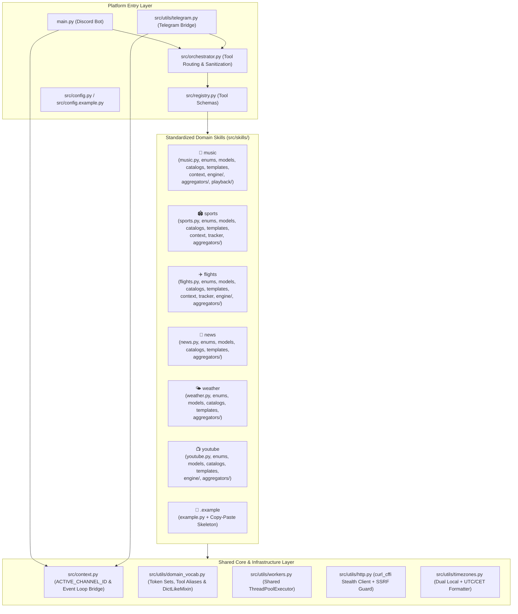

# 🤖 Local Ollama Multi-Skill Discord & Telegram AI Agent

A privacy-first, locally hosted AI research and entertainment assistant for **Discord** and **Telegram**, powered by **Ollama** (`gemma4:e4b`, `qwen3:8b`, etc.) with a modular, multi-threaded Python skill engine.

Designed specifically to give compact local LLMs (4B–8B parameters) **deterministic, real-time tool execution**, pre-verified links, timezone-aware schedules, and background event tracking without relying on paid cloud LLM APIs.

---

## ✨ Key Capabilities

| Domain | Capabilities |
| :--- | :--- |
| 🎵 **Music Discovery & Audio DSP** | Multi-source chart & underground discovery (**Last.fm**, **Deezer**, **Beatport**, **FreqBlog**, **iTunes RSS / Billboard**), **Genre × Mood Matrix**, **3×3 Tempo × Intensity Spectrum Shifting** (`faster`, `slower`, `harder`, `softer`), **In-Memory DSP (`miniaudio` + `numpy`) BPM/Key/Gain Analysis**, native **`gemma4:e4b` Audio Listening**, and **👍 Song-Card Reaction Similar-Track Discovery**. |
| 🏟️ **Live Sports, CS2 Esports & Decimal Odds** | Real-time scoreboards, fixtures, and standings for **Soccer** (UCL, EPL, La Liga, Serie A, Bundesliga, Ligue 1, MLS, etc.), **NHL**, **NBA**, **NFL**, **MLB**, **UFC**, **Formula 1** (3-day session timings & driver/constructor standings), and **Counter-Strike 2** (**HLTV**, **Liquipedia**, **ESL/BLAST** live streams). Includes **Decimal Betting Odds** with implied win probabilities and **Background Live Match Tracking** (kickoff, goals, red cards, period/halftime, full-time alerts). |
| ✈️ **Flights, Airfare Calendars & Live Radar** | Live **Google Flights** itinerary scraping (Best, Cheapest, Shortest/Fastest), **Round-Trip & Flexible-Date Price Grids**, **Direct/Nonstop Route Schedules**, and **Live Commercial Flight Status & Radar Telemetry** (**Flightradar24** & **ADSB.lol** live ADS-B altitude/groundspeed/heading). Includes **Background Flight Status & Route Price Drop Alerts**. |
| 🌐 **Web Research, News & Weather** | Multi-engine web search (**DuckDuckGo** + **Brave Search** fallback), SSRF-hardened stealth article reader (**Jina Reader** + **curl_cffi** TLS impersonation), **YouTube Transcript & Metadata** analyzer, **Google News RSS** headlines, and **Open-Meteo** current + up to **16-day weather forecasts** (with **wttr.in** automatic fallback). |
| 💬 **Dual-Platform Discord + Telegram** | Runs simultaneously on **Discord** (with per-channel concurrency locks and 👍 song-card reactions) and **Telegram** (zero-dependency HTTPS long-polling bridge with fail-closed user/chat allowlist security). |

---

## 🏗️ Architecture Overview

Every skill under `src/skills/` follows an identical, standardized package layout (`__init__.py`, `<skill_name>.py`, `enums.py`, `models.py`, `catalogs.py`, `templates.py`, `aggregators/`, plus optional `context.py`, `tracker.py`, `engine/`, `playback/`), with a copy-paste-ready skeleton in `src/skills/.example/`. Cross-cutting concerns live in a shared core execution context (`src/context.py`), shared domain vocabularies (`src/utils/domain_vocab.py`), and a centralized background worker pool (`src/utils/workers.py`).



### 📁 Standard Skill Package Layout (`src/skills/<skill_name>/`)

Every skill package under `src/skills/<skill_name>/` follows this exact structure, with the primary module named `<skill_name>.py` to match its folder name (see `src/skills/.example/` for a copy-paste-ready skeleton):

```text
src/skills/<skill_name>/
├── __init__.py             # Public exports (skill_<skill_name>_* entrypoints & optional tracker)
├── <skill_name>.py         # Constructor-style main module with LLM tool entrypoint(s) (skill_<skill_name>_*)
├── enums.py                # Strictly enum.StrEnum classes (modes, states, providers)
├── models.py               # Strictly @dataclass(slots=True) domain models
├── catalogs.py             # Strictly static registries, lookup dicts & frozenset stopwords
├── templates.py            # Concise LLM formatting instructions (3–4 lines max)
├── context.py              # [Optional] Per-channel state, arg enrichment & turn-0 recovery
├── tracker.py              # [Optional] Asyncio background polling service (<Domain>TrackerService)
├── engine/                 # [Optional] Pure domain algorithms, parsers, or DSP helpers
└── aggregators/            # External API & scraping providers
    ├── __init__.py
    ├── base.py             # Abstract base class (Base<Domain>Aggregator)
    └── example_provider.py # Concrete data fetcher using src/utils/http.py & workers.py
```

#### 🧩 Adding a New Skill in 5 Steps
1. **Copy the skeleton** to `src/skills/<your_skill>/` and rename `example.py` to `<your_skill>.py`:
   ```bash
   cp -r src/skills/.example src/skills/<your_skill>
   mv src/skills/<your_skill>/example.py src/skills/<your_skill>/<your_skill>.py
   ```
2. **Define your types & static data**:
   - Put `StrEnum`s in `enums.py`, `@dataclass(slots=True)` models in `models.py`, static dicts/`frozenset` stopwords in `catalogs.py`, and concise LLM rules in `templates.py`.
3. **Implement your data provider** in `aggregators/` inheriting from `Base<Domain>Aggregator` in `aggregators/base.py`, using `fetch_json` / `fetch_text` from `src.utils.http` and `map_in_workers` / `submit_to_worker` from `src.utils.workers`.
4. **Implement your tool entrypoint** (`def skill_<your_skill>_info(...) -> str:`) in `<your_skill>.py` and export it in `src/skills/<your_skill>/__init__.py` and `src/skills/__init__.py`.
5. **Register the tool** in `src/registry.py` (`RESEARCH_TOOLS` / `CHAT_TOOLS`) and add parameter synonyms to `TOOL_ARG_ALIASES` in `src/utils/domain_vocab.py`.

#### 💡 Why Code-First Skill Packages Instead of `SKILL.md`?
Many coding and OS agents (like Claude Code, Cursor, or OpenClaw) use `SKILL.md` files — Markdown instruction manuals that a large cloud model reads at runtime to figure out what shell commands or scripts to run across multiple turns.

This bot intentionally uses **compiled Python skill packages + `templates.py`** instead:
- **Built for Fast Local Models (`4B–8B`)**: Rather than asking a small local model to read a Markdown guide and improvise CLI commands across 3–4 turns, each skill exposes a strict, typed Python function (`<skill_name>.py`) and appends concise formatting rules (`templates.py`) directly to the tool output in a **single turn**.
- **Deterministic Speed & Concurrency**: Heavy lifting — like 24-thread worker fan-out, API fallback chains, and in-memory MP3 FFT signal processing — runs in deterministic, unit-tested Python rather than prompt instructions.

---

## 🚀 Getting Started

### 1. Prerequisites
- **Python 3.11+** (tested up to Python 3.14)
- **[Ollama](https://ollama.com/)** running locally (`ollama serve`)
  - Pull your preferred model(s), e.g.:
    ```bash
    ollama pull gemma4:e4b
    ollama pull qwen3:8b
    ```

### 2. Installation
Clone the repository and install dependencies into a virtual environment:

```bash
git clone <your-repo-url>
cd discord-bot
python -m venv .venv
# Windows PowerShell:
.\.venv\Scripts\Activate.ps1
# Linux / macOS:
# source .venv/bin/activate

pip install -r requirements.txt
```

### 3. Configuration (`.env` and `src/config.py`)
1. Copy the environment variable template and add your **Discord Bot Token** (and optional API keys):
   ```bash
   cp .env.example .env
   ```
2. Copy the public bot persona/model configuration template to `src/config.py` (which is git-ignored so your custom prompts and local model tags stay private):
   ```bash
   cp src/config.example.py src/config.py
   ```
   *(If `src/config.py` is omitted, the bot automatically loads the default `research` and `chat` profiles from `src/config.example.py`.)*

### 4. Run the Bot

#### Option A: Run Natively
```bash
python main.py
```

#### Option B: Run in a Hardened, Self-Contained Docker Stack (`ollama` + `discord-bot`)
For complete filesystem and network isolation from the host machine:
```bash
docker compose up -d --build
```
- **Dedicated GPU `ollama` Container**: Runs `ollama/ollama` inside a sibling container on a private internal bridge network (`http://ollama:11434`) with GPU passthrough (`capabilities: [gpu]`) and an isolated `ollama_models` volume. Missing models in `MODES` are pulled automatically on first boot (`OLLAMA_AUTO_PULL=true`).
- **Zero Host Bind-Mounts**: No host folders are mounted into either container (`ollama_models`, `bot_data`, and `bot_workspace` use isolated Docker-managed named volumes).
- **Read-Only Root Filesystem**: `/`, `/usr`, and `/app` in `discord-bot` are mounted read-only; the bot runs as an unprivileged user (`1000:1000`) with `cap_drop: [ALL]` and `no-new-privileges:true`.

---

## 🎮 Commands & Natural Language Prompts

### Bot Commands & Interactions
| Discord | Telegram | Description |
| :--- | :--- | :--- |
| `!mode <profile>` | `/mode <profile>` | Switch active AI model/persona profile (e.g., `research`, `chat`; restricted to `BOT_OWNER_ID`). |
| `!reset` | `/reset` | Wipe conversation history and per-channel tool caches for the current channel. |
| React with 👍 on a song card | — | Automatically finds and posts a fresh, acoustically similar song to the reacted track. |

### Natural Language Examples
- **Music Discovery & Spectrum Shifts**:
  - *"Play me a dark techno banger"*
  - *"Give me something a little faster and harder"* (or reply directly to a song card with *"slower"* / *"softer"*)
  - *"Find tracks that harmonically mix with Strobe by Deadmau5"*
- **Sports, CS2 Esports & Live Match Tracking**:
  - *"What are the Champions League and NHL games today and their odds?"*
  - *"When is the next F1 race and what are the session times?"*
  - *"What's happening in CS2 right now and what are Vitality's player stats?"*
  - *"Track the Real Madrid game"* / *"Which games are we tracking right now?"* / *"Stop tracking the Real Madrid game"*
- **Flights, Airfare Calendars & Live Radar Tracking**:
  - *"Find the cheapest round-trip flights from New York to Tokyo in November for 2 weeks"*
  - *"When are the direct flights from JFK to LHR?"*
  - *"Where is flight BA117 right now?"*
  - *"Track flight BA117"* / *"Track the price for JFK to LHR on Nov 21"* / *"Stop tracking flight BA117"*

---

## 🧪 Running the Test Suite

The repository includes **260+ unit, concurrency, combinatorial, and architectural boundary tests** (executing completely offline in ~6 seconds):

```bash
python -m unittest discover -s tests -p "test_*.py"
```

To run the architectural & module boundary guardrails specifically:

```bash
python -m unittest tests/test_architecture_and_boundaries.py
```

See [CONTRIBUTING.md](CONTRIBUTING.md) for code quality standards and skill authoring guidelines.
